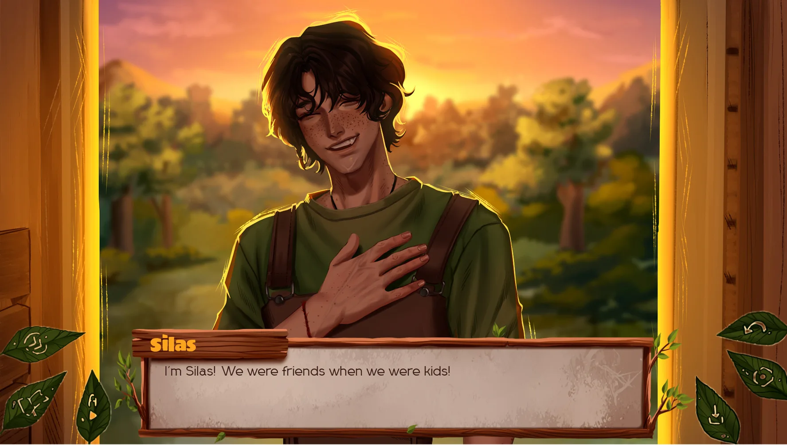
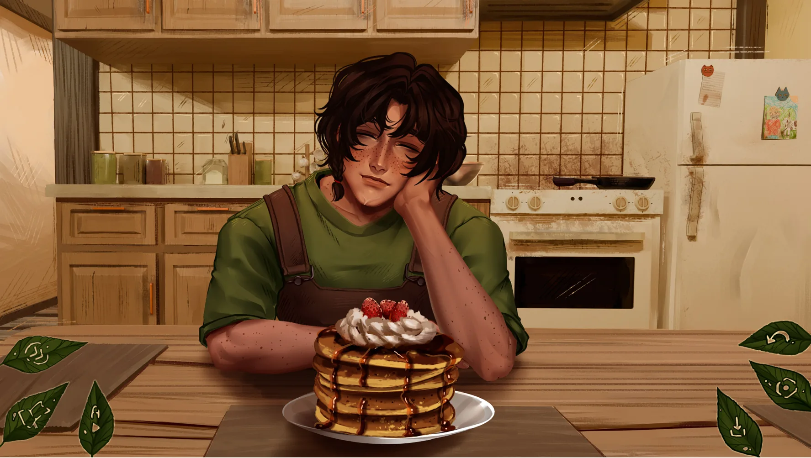
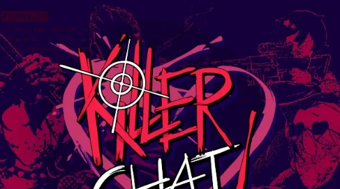
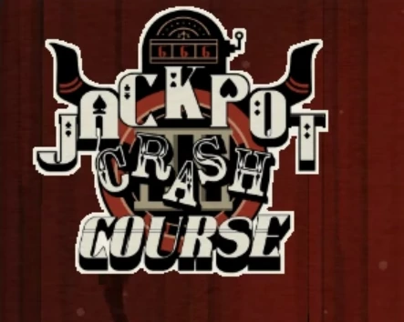

# The False Sun Browser Horror Game

The False Sun is a browser horror game site built around stories that begin with familiar places and gradually reveal that something important is wrong. The central game opens on a grandfather's farm, a setting filled with soft grass, warm light, family memory, and the expectation of safety. That comfort does not remain stable. Details drift out of place, gaps in memory become harder to ignore, and a familiar face starts to feel like part of a performance. The website places the playable game first and then supports it with screenshots, videos, original analysis, related games, and practical browser guidance.

## Play The False Sun Online

- **Website:** [https://the-false-sun.org/](https://the-false-sun.org/)
- **Launch the game:** <a href="https://the-false-sun.org/" target="_blank" rel="noopener">Play The False Sun online</a>
- **Collection:** Browser horror, visual novels, surreal stories, character-driven games, videos, screenshots, and FAQ guides

The live website is the intended way to experience the project. The public site provides the complete header, game search, Play Game menu, deferred iframe, fullscreen and sharing controls, game-card strip, long-form content, responsive videos, and footer navigation.

## Familiar Light, Unfamiliar Meaning

The False Sun creates horror through contradiction. Daylight should make a place easier to understand, yet the brightness on the farm does not guarantee that the player is seeing the truth. Family should provide continuity, yet memory cannot fully support the story being presented. The game uses these conflicts to make ordinary details feel important. A pause in conversation, a repeated phrase, a landscape that seems too calm, or a moment of affection can become evidence that the apparent safety of the farm has been carefully arranged.

The browser page respects that slow rhythm. Its launch panel gives players a brief spoiler-light description and a clear Play Now button. The game iframe loads only after interaction, allowing the cover image and surrounding page to appear quickly. A gradual background transition connects the introduction card to the cover artwork, helping the game frame feel like one composed scene rather than an advertisement placed above an unrelated article.

## Story Images and Visual Context

Screenshots are distributed through the guide to support the subjects being discussed. Images can show the farm, character expressions, dialogue framing, or moments where warmth begins to feel staged. Every image uses a short local path and meaningful alternative text. This helps screen-reader users understand the role of the artwork and gives search engines accurate context without repeating long lists of keywords.

## One Shared Format, Different Games

## Killer Chat

Killer Chat brings digital conversation and uncertainty into the collection. The player must interpret messages, character behavior, and the danger hidden behind apparent connection. Its page uses the same site structure as The False Sun while adopting its own screenshots, video references, and editorial focus. The guide avoids copying a reference page and instead explains the game's appeal through original discussion of trust, identity, online intimacy, and route choices.

## Jackpot Crash Course

Jackpot Crash Course expands the catalog into casino spectacle and public judgment. Eddie enters a televised competition where criminal contestants are offered the possibility of a pardon. Bright lights and game-show energy make each round entertaining for an audience, while alliances, reputation, violence, and the design of the rules create pressure for the people on stage. The page includes the playable iframe, two videos, four supporting images, original long-form analysis, route guidance, browser help, and ten FAQ entries.

## Browser Compatibility and Content Guidance

Desktop or laptop fullscreen is recommended for the most comfortable game text and artwork. Mobile visitors can often play in landscape orientation, although iframe focus, audio permissions, storage behavior, and screen size vary by browser. If a frame remains black, visitors can wait for remote assets, refresh once, and check whether privacy extensions, script blockers, or managed networks are preventing the external host from loading.

Content notes help players decide whether a game fits their current mood. The collection may include psychological horror, obsessive relationships, violence, blood, gore, coercion, public humiliation, or disturbing imagery. The colorful or peaceful appearance of a game is not always a reliable guide to its themes, so each long-form page provides context without revealing every plot turn.

## Plan Your First Visit

Start with the game's introduction and content notes before opening the player. Screenshots offer a quick impression of the artwork and reading interface, while the accompanying guide explains the premise without requiring you to follow a complete walkthrough. Choose a title because its mood interests you, rather than assuming that every game in the collection offers the same controls, length, or type of story.

For a first session, leave enough time to read the opening carefully. If the game presents choices, notice how their tone differs before selecting a response. If it follows a linear story, enjoy the pacing without expecting every conversation to branch. Individual games have their own rules, and a related title is not necessarily a sequel or an experience by the same creator.

Keep the guide page available when you need a reminder about browser controls. Fullscreen can make dialogue easier to read, but it does not change the game's compatibility requirements. Sound may need a click before it starts, and a slow connection can delay the initial loading screen. If something fails, check the page's help rather than assuming your progress has been saved.

When you are ready for another experience, use the shared game cards or navigation menu to browse a different title. Read its own description and content guidance before beginning. Sharing the page address gives a friend the same starting point without implying that your choices, progress, or browser saves will transfer to their device.
